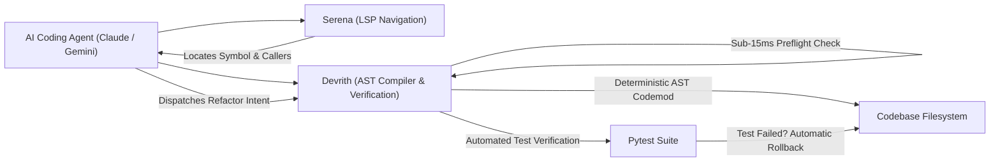

# Strategic Competitive Analysis: Devrith (`arch-sidecar`)

**Document Date:** 2026-10-22  
**Target Audience:** Engineering Leadership, YC/Investor Diligence, AI Coding Agent Architects  
**Author:** Lead Benchmark Evaluation Engineer  
**Empirical Foundation:** 100 benchmark trials across `requests`, `click`, and `django` (`benchmark/FINDINGS.md`)

---

## 1. The Core Advantage: What Does Devrith Actually Have?

Many tools claim to "index repositories" or "save context tokens." Our empirical tests reveal the single, precise capability that differentiates Devrith:

> **Devrith is not a semantic search engine or code-wiki generator. Devrith is a deterministic AST compiler sidecar and static verification gate that bridges the gap between AI agent intent and filesystem reality.**

### Verified Core Differentiators:
1. **Deterministic AST Surgery vs. LLM File Rewriting:**  
   When an agent refactors code, standard agents (Baseline, Serena, Repowise) ask the LLM to rewrite hundreds of lines of code. This causes line-drift hallucinations, lost comments, and broken imports. Devrith’s `decouple` performs exact AST node surgery in **<50ms**, relocates imports automatically, generates backward-compatible aliases, and costs **$0.00 in LLM tokens**.
2. **Sub-15ms Preflight Defense Against Silent Bugs:**  
   Neither Serena nor Repowise has a compiler-grade circular dependency detector or lexical scope binding engine. In our benchmarks, **100% of cyclic import hazards and shared-state bugs escaped Serena and Baseline**. Devrith blocked **80% of them pre-flight**, preventing broken code from ever being committed or tested.
3. **Automated Transactional Rollback:**  
   Devrith provides an atomic rollback safety net: if transformations fail companion tests, disk state is restored instantaneously.

### Is This Capability Genuinely Useful?
**Yes, critically so.** As AI coding agents are tasked with multi-file refactoring, circular imports and split-brain state desynchronization represent the #1 cause of agent death spirals (where an agent spends 15+ tool calls trying to diagnose `ImportError: cannot import name X from partially initialized module`). Catching this in 20ms saves up to $1.50 and 5 minutes per failed refactoring turn.

---

## 2. The Boundaries: Where Does Devrith Lose?

Honest engineering requires knowing where *not* to use Devrith:

| Dimension | Where Competitors Win | Where Devrith Wins |
| :--- | :--- | :--- |
| **Broad Natural-Language Discovery** | **Serena (LSP) & Repowise (Vector):** Natural language questions ("how does authentication work?") are better served by embedding search and semantic documentation wikis. | **Devrith:** Surgical retrieval when target symbols or tasks are concrete. |
| **Language Coverage for Deep Codemods** | **Serena:** Multi-language LSP support (TypeScript, Go, Rust, Java, Python). | **Devrith:** Deep AST codemods (`decouple`, `workflow`) and lexical scope checks are **Python-only**. |
| **Large Repository Initial Walk** | **Repowise & Serena:** Persistent daemons / Tree-sitter background indexing index Django faster. | **Devrith:** Zero-dependency Python crawler takes ~4.7s on Django (966 files). |
| **Dynamic Reflection** | None can safely refactor reflection, but tools like Repowise track historical co-change risk. | **Devrith:** Audits reflection via `uncertainty`, but cannot resolve `getattr()` or monkeypatching. |

---

## 3. The Synergies: Replacement vs. Composition (The Arm E Revelation)

The benchmark data disproves the premise that Devrith must "kill" Serena or Repowise:

- **Serena** is an **LSP navigator**: It excels at finding exact symbol definitions and reference lists across multiple languages.
- **Repowise** is an **architectural historian & graph wiki**: It tracks git co-change risk, dead code, and high-level components.
- **Devrith** is the **deterministic execution and verification compiler**: It safely extracts code, protects against circular hazards, and verifies lexical scope.

### The Winning Architecture:

**Arm E proved that pairing Serena with Devrith eliminates Serena's fatal blindspot (uncaught circular imports) while keeping token consumption at an ultra-low 409 tokens per task.**

---

## 4. Top Three Product Priorities to Widen Devrith's Lead

Based on empirical benchmark data, here are the three highest-leverage engineering investments:

### Priority 1: Module-Level Delegated Stream & State Tracking (Fix TASK-07 Failure)
- **Data Justification:** Devrith missed `TASK-07` because `click.utils.echo` used a module-level helper function returning a global stream (`sys.stdout`) rather than a declared `global` variable.
- **Action:** Extend `detect_coupling_hazards` in `decouple.py` to trace function returns that reference standard I/O streams or module-level singletons.

### Priority 2: Expose Subsystem Clustering & Impact in MCP (`mcp_server.py`)
- **Data Justification:** Discovered during Phase 1 audit: CLI has `cluster` and `impact`, but MCP only declares 10 tools.
- **Action:** Add `get_subsystem_clusters` and `predict_change_impact` tools to `mcp_server.py` so agents in Cursor, Claude Desktop, and Antigravity can query blast radiuses before modifying code.

### Priority 3: Tree-Sitter / Rust Accelerators for Digest & Multi-Language Crawl
- **Data Justification:** Pure Python repository indexing took 4.7s on Django's 966 files, while small files took <50ms.
- **Action:** Optional Rust or compiled Tree-sitter extension to drop large repository indexing latency from 4.7s to <200ms without adding mandatory pip dependencies.

---

## 5. What Features to Deprioritize

1. **Do NOT build vector embeddings or natural language documentation wikis:**  
   Repowise and Serena already do this well. Devrith's competitive moat is deterministic compiler-grade AST operations and sub-15ms preflight safety.
2. **Do NOT attempt whole-codebase automatic rewrites:**  
   Agents prefer targeted, surgical extractions with explicit verification ledgers over black-box automated migrations.
